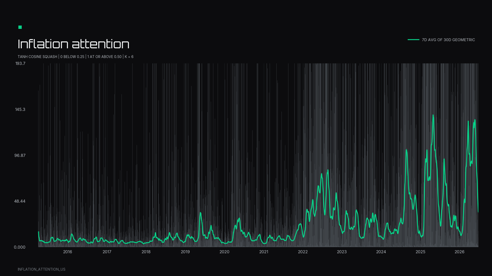

# semantic-factors

[](https://github.com/NosibleAI/semantic-factors/actions/workflows/semantic-factors.yml)
[](https://pypi.org/project/semantic-factors/)
[](https://pypi.org/project/semantic-factors/)
[](LICENSE)

**Turn web text into semantic stock betas.**

`semantic-factors` is an open-source Python library that turns NOSIBLE World event text into
transparent daily semantic factors. You write the definition in plain sentences, inspect every
step of the output, and rerun it when the research question changes.

## Why this exists

In 1973, Robert Merton argued that asset prices move on news about state variables, the shifting
conditions of the world that investors actually price. He called it the
[ICAPM](https://www.jstor.org/stable/1913811). The problem? Language modelling was nowhere.
Nobody could measure the state.

So quantitative finance took a different path: we built risk models from prices, not texts. The
proxies were brilliant, and they carried the field for half a century. But
[400+ published factors](https://papers.ssrn.com/sol3/papers.cfm?abstract_id=3341728) later,
returns decay [58% after publication](https://papers.ssrn.com/sol3/papers.cfm?abstract_id=2156623)
and [65% of anomalies fail to replicate](https://academic.oup.com/rfs/article/33/5/2019/5236964).
The exhaustion is not intellectual. It is informational: several hundred rearrangements of the
same prices and filings.

We're not in 1973 anymore. Word2Vec, BERT, LLMs: language modelling is here, and the state of the
world is finally measurable. The evidence has arrived with it. Factors estimated from news text
alone price the cross-section of stocks better than the standard factor models out of sample
([Bybee, Kelly and Su, 2023](https://papers.ssrn.com/sol3/papers.cfm?abstract_id=3895277)). We can
build the future that should have been.

The future that could have been is now pip-installable:

```bash
python -m pip install "semantic-factors[plot]"
```

## See a real semantic factor

### Inflation attention

This factor turns US coverage of prices, costs, and inflation expectations into a dated signal.
The chart is a real package-rendered output, not mock data.

<p align="center">
  
</p>

<p align="center"><strong>Inflation attention</strong> · US coverage of prices, costs, and inflation expectations</p>

The workflow is simple:

1. Write relevance anchors and polarity pairs in plain text.
2. Score NOSIBLE World events with the same embedding geometry used by the World archive.
3. Export a dated factor series, a chart, the matched events, and diagnostics.
4. Align the series with stock returns to estimate stock-specific factor betas.

The important part is visible. The anchors, poles, filters, threshold, weighting, dates, and
arithmetic are all ordinary Python values. There is no catalogue lookup required to define a new
factor. If you can describe a risk in sentences, you can measure it.

## Who it is for

This is for quant portfolio managers and researchers who need differentiated signals and want to
see exactly how a signal was made before putting it into a risk model. It earns its keep when a
benchmark index arrives late, when a risk concept is too specific for a standard data vendor, or
when a team wants to test a new definition this afternoon instead of waiting for a new data
product.

## Before you start

Every live build needs two credentials:

- `NOSIBLE_API_KEY` gives the package access to NOSIBLE World event coverage and denominators.
  Come get your World API key at [nosible.com](https://www.nosible.com/semantic-factors).
- `OPENROUTER_API_KEY` embeds your anchors and poles through an OpenAI-compatible endpoint.

The package retrieves through the grouped `POST /api/search` World contract and computes factor
mathematics locally. It does not use an `/api/factors` scoring route. Your definitions stay in
your code; the event text stays in World.

```bash
export NOSIBLE_API_KEY=nos_sk_...
export OPENROUTER_API_KEY=sk-or-...
```

Python 3.10 or newer is required.

The complete set of 30 worked factors, with definitions, charts, CSV files, and the research
lineage behind each one, lives at
[semantic-factors on NOSIBLE](https://www.nosible.com/semantic-factors). The repository examples
are definitions you can copy and edit:

- [Geopolitical risk](examples/geopolitical_risk.py)
- [Trade policy uncertainty](examples/trade_policy_uncertainty.py)
- [US labour action](examples/us_labour_action.py)
- [Crop infestation](examples/crop_infestation.py)

The charts are examples of the method, not one-to-one replications of the published indices. They
use different source coverage, definitions, embedding geometry, filters, and aggregation rules.

## Build a factor

The definition is the research choice, so the definition is code you can read. Anchors describe
what belongs in the factor. Each polarity pair keeps one topic fixed while expressing a
higher-risk and a lower-risk state of it.

```python
import os

from semantic_factors import SemanticFactor

factor = SemanticFactor(
    name="geopolitical_risk",
    anchors=[
        "Military forces attack, invade, or occupy another sovereign state's territory.",
        "Fighting expands across new fronts and reaches densely populated civilian areas.",
        "A ceasefire collapses and sustained combat operations resume between the two armies.",
        "Air strikes or naval attacks strike targets inside another country's borders.",
        "A government mobilises troops and moves heavy weapons towards a contested border.",
        "Two governments exchange threats and move visibly towards open armed confrontation.",
        "A territorial dispute worsens and both claimants reinforce their frontier garrisons.",
        "Diplomatic talks break down and each government withdraws its ambassador in protest.",
        "An organised group bombs or shoots civilians in order to cause widespread terror.",
        "Sabotage damages the pipelines, cables, or railways a state depends on.",
        "An attempted coup challenges control of a national government by force.",
        "Insurgents seize provinces and the national army withdraws from the territory.",
    ],
    poles=[
        (
            ["The confrontation is escalating and is likely to get significantly worse."],
            ["The confrontation is de-escalating and a settlement is being negotiated."],
        ),
        (
            ["More forces are being committed and the fighting is spreading."],
            ["Forces are withdrawing and the fighting has largely stopped."],
        ),
    ],
    filters={"language": "en"},
    floor=0.30,
    tanh_scale=0.10,
)

daily = factor.compute(
    weights="netlocs",
    stabilize=True,
    polarity_weighted=True,
    start_from="2015-01-01",
    stop_at="2026-06-26",
    api_key=os.environ["NOSIBLE_API_KEY"],
    embed_api_key=os.environ["OPENROUTER_API_KEY"],
    embed_base_url="https://openrouter.ai/api/v1",
)

factor.to_csv(path="output/geopolitical_risk.csv")
factor.plot(
    title="Geopolitical risk",
    annotate=False,
    path="output/geopolitical_risk.png",
)
```

Notice what just happened. In 1973 this was the unmeasurable part: "the state of the world" was a
theoretical object with no instrument attached. Here it is twelve sentences and two polarity
pairs, and you can edit every word.

The full definitions are deliberately longer than this README snippet. Open the source files to
see every sentence, pair, episode, and output setting. The package is permissionless at the point
where it matters: edit the text, change the scope or threshold, and run the same code again.

## What the library does

### 1. Define

Use sentences instead of a hidden label:

- **Relevance anchors** describe the kinds of World events the factor should find.
- **Polarity pairs** express the same topic in higher-risk and lower-risk states.
- **Filters** define the eligible universe, such as a country or language.
- **The cosine floor** decides how close an event must be to the definition before it counts.

Use several varied anchors for a broad construct. Use matched polarity pairs for each distinct
topic. Clear sentences make the research object easier to review, easier to criticise, and easier
to improve. That is the point.

### 2. Retrieve and score

The package embeds the definition text, retrieves date-local candidates from NOSIBLE World, and
reranks the candidates with exact cosine scores. The event text stays in World. The embedding
provider sees only the sentences you submit.

For every date, the package retains the eligible denominator needed by the selected weighting
scheme. That keeps the final series tied to the coverage of the World universe rather than to an
unreported sample.

### 3. Aggregate

Relevant events are weighted by one of the built-in schemes and aggregated into a daily series.
With polarity pairs, the high-minus-low pole gap is passed through `tanh` and used to move the
event contribution toward the higher-risk or lower-risk end of the pair. `stabilize=True` uses a
trailing denominator average to reduce corpus-growth effects without erasing event spikes.

### 4. Inspect and export

`compute()` returns a Polars frame and stores it on `factor.daily`. The package also keeps the
retained events and a diagnostic record containing the resolved floor, request counts, effective
window, filters, weighting, and timing.

```python
factor.weekly()
factor.monthly()
factor.to_csv(path="factor.csv")
factor.to_parquet(path="factor.parquet")
factor.events
factor.diagnostics
```

The daily export includes the date, factor value, polarity, matching-event count, eligible-event
count, raw contribution, denominator volume, stabilisation baseline, and share.

## From semantic factor to stock beta

One semantic factor gives you a dated measure of a common risk. Align it with stock returns,
control for the market, and estimate how each stock responds when the factor moves. The result is
a stock-specific loading you can inspect before using it in a risk model. This is the ICAPM's
missing half finally connected: a named state variable on one side, a measured exposure on the
other.

```python
factor.compute(
    weights="netlocs",
    start_from="2015-01-01",
    stop_at="2026-06-26",
)
loadings = factor.regress(
    tickers=["RTX.US", "XOM.US", "AAPL.US", "JPM.US"],
    eodhd_api_key=os.environ["EODHD_API_KEY"],
)
print(loadings)
print(factor.stats)
```

The regression output is calculated from the factor series and adjusted closing prices. A beta is
a conditional historical association, not a claim that the factor caused the return or that the
relationship will persist. There is no backtest or investment recommendation in this example.

## Weighting schemes

| `weights=` | Numerator contribution | Matching denominator |
| --- | --- | --- |
| `equal` | One per matching event | Eligible event count |
| `coverage` | Published article count | Total article count |
| `netlocs` | Distinct publisher count | Total distinct-publisher count |
| `materiality` | Materiality score | Total materiality score |
| `sentiment` | Sentiment mass | Total sentiment mass |
| `relevance` | Relevance cosine | Eligible event count |

## Retrieval and reproducibility

World search is date-local approximate retrieval followed by exact reranking. The request budget,
resolved floor, filters, weighting, effective dates, and timing are recorded in diagnostics. The
client caches immutable responses and embeddings so a repeated run can continue without repeating
work that already succeeded.

The output is reproducible for a fixed World snapshot, embedding model, definition, threshold,
filters, weighting scheme, and package version. Different data snapshots or definitions can
produce different series. That is expected, and it is why the definition is shown alongside the
data. A factor whose construction you cannot read is a factor you cannot trust; this one you can
read top to bottom.

## Command line

```bash
semantic-factors compute --spec factor.json --out ./output
semantic-factors fields --search materiality
semantic-factors schemes
```

The compute command writes daily and monthly CSV files, diagnostics, retained events, and a PNG
when the plotting extra is installed.

## Limitations

- Retrieval is approximate before exact reranking and is governed by the candidate budget.
- A semantic factor is a research signal. It is not investment advice.
- Exposure estimates do not establish causality and should be validated out of sample.
- NOSIBLE World data access and any market-price provider are governed separately from this
  source package.

## Development

```bash
python -m pip install -e ".[dev]"
pytest
ruff check .
mypy src
python -m build
```

## Where to start

Start with the worked examples, then replace the sentences with the question your book actually
needs answered. That last step is the whole product: for fifty years the state of the world was
the variable nobody could measure. Now it is an argument to a Python function.

## Contributing and security

Contributions are welcome. See [CONTRIBUTING.md](CONTRIBUTING.md) for the development workflow and
[CODE_OF_CONDUCT.md](CODE_OF_CONDUCT.md) for community expectations. Please report suspected
vulnerabilities privately as described in [SECURITY.md](SECURITY.md).

`semantic-factors` is licensed under the [Apache License 2.0](LICENSE). The bundled fonts retain
their SIL Open Font License; attribution details are in [NOTICE](NOTICE).
